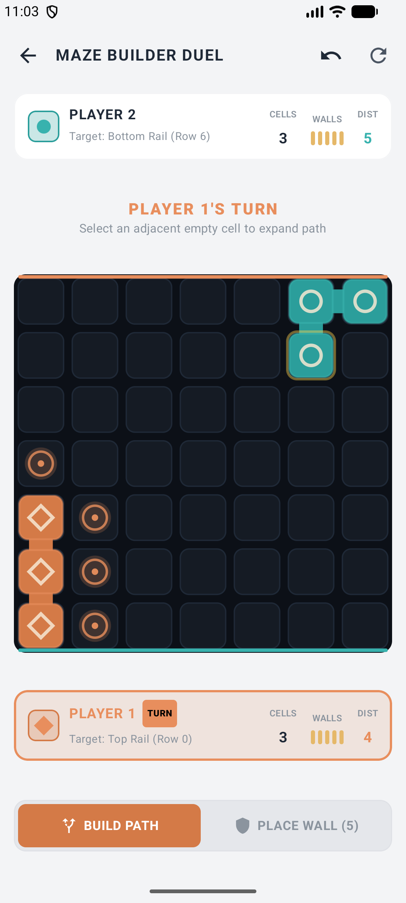
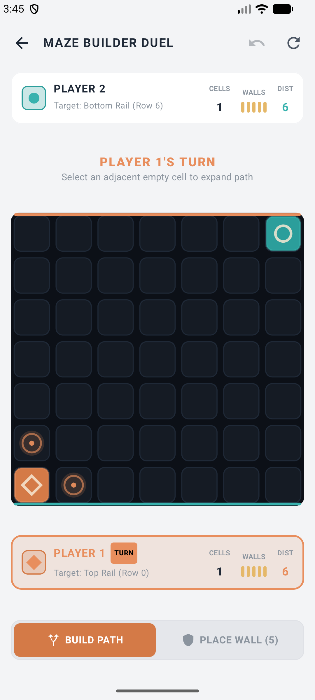
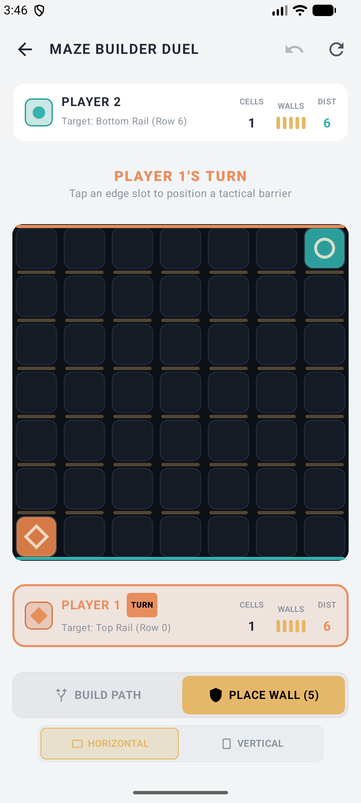

# Maze Builder Duel ⚔️🧱

**Maze Builder Duel** is a strategic, turn-based competitive Android game built with **Jetpack Compose** and **Kotlin**. Two players race across a 7×7 grid, balancing path expansion and tactical wall placement while ensuring every route remains valid.

---

## 🎮 Game Overview & Rules

- **Core Objective**: Two players race across a 7×7 grid.
  - **Player 1**: Starts at the bottom-left and must reach any cell on the top row.
  - **Player 2**: Starts at the top-right and must reach any cell on the bottom row.
- **Two Actions Per Turn**: On each turn, a player chooses exactly one action:
  1. **Build Path**: Claim one empty cell orthogonally adjacent to your existing route.
  2. **Place Wall**: Erect a barrier edge to redirect or delay your opponent.
- **Expanding Your Route**:
  - Paths expand only Up, Down, Left, or Right (no diagonal expansion).
  - Claimed cells remain permanently yours — opponent territory cannot be crossed or stolen.
- **The Golden Barrier Rule**:
  - Each player starts with 5 walls.
  - Walls redirect and force detours, but **no wall placement may completely trap a player or eliminate every possible path to their goal**.
  - Validated in real-time using **Breadth-First Search (BFS)** before accepting any wall placement.
- **Fallback Progress Tiebreaker**:
  - In the rare edge case where both players have 0 walls remaining and neither player has any legal path moves left, the player whose network is closest to their goal row wins.

---

## ✨ Key Features

- **Modern UI / UX**: Built entirely with **Jetpack Compose** and **Material 3**, featuring sleek custom dark/light styling, fluid animations, and custom canvas rendering (`BoardCanvas`).
- **Smart Validation Engine (`MazeEngine` & `PathFinder`)**: Robust graph traversal algorithms ensure gameplay integrity and prevent unwinnable deadlocks.
- **Immersive Feedback**: Haptic feedback (`HapticManager`) and sound effects (`SoundManager`) for tactile and auditory engagement.
- **Statistics & Settings**: Track win rates, match counts, and customize preferences via local repositories (`SettingsRepository` & `StatisticsRepository`).
- **Interactive Screens**: Home Screen, Game Play Screen, How To Play Guide, Settings, Result Screen, and About screen with clean Navigation 3 / navigation graph setup.

---

## 🛠️ Tech Stack & Architecture

- **Language**: Kotlin 100%
- **UI Framework**: Jetpack Compose, Material 3, Canvas API
- **Architecture**: MVVM (Model-View-ViewModel) with StateFlow
- **Algorithms**: BFS (Breadth-First Search) for path finding and dead-end/trap detection
- **Persistence**: SharedPreferences / DataStore repositories
- **Testing**: JUnit unit tests (`MazeEngineTest`) and instrumented tests

---

## 📱 Screenshots

| Home Screen | Game Board | Action Mode |
| :---: | :---: | :---: |
|  |  |  |

---

## 🚀 Getting Started

1. Clone the repository:
   ```bash
   git clone https://github.com/abdullah-ateeq/Maze-Builder-Duel.git
   ```
2. Open the project in **Android Studio** (Koala / Jellyfish or newer).
3. Sync Gradle and run the `:app` configuration on an emulator or physical Android device (minSdk 24+).

---

## 📄 License

Project developed for competitive strategy puzzle enthusiasts. Enjoy the duel!
